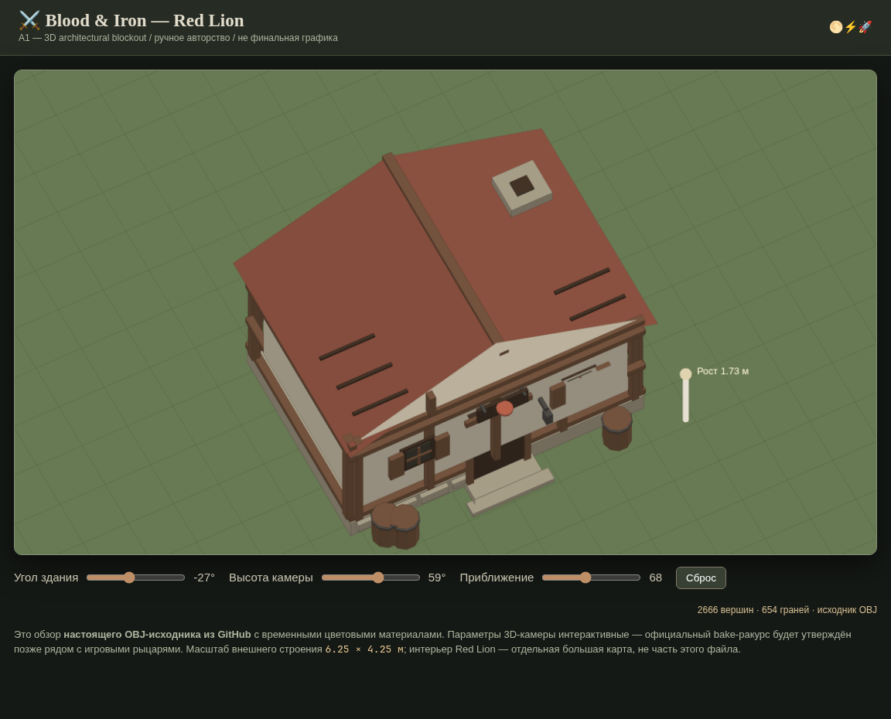

# myaso.io — Blood & Iron: Medieval Realism
## Утверждённый Art Direction Brief v1.0

**Статус:** художественное направление утверждено владельцем проекта, 19 октября 2026 года.
**Вид игры:** браузерная multiplayer PvP / exploration RPG, фиксированный вручную созданный мир, отдельные загружаемые интерьеры.
**Первая художественная локация:** Moonvale → Greyhaven → улица Red Lion → таверна Red Lion.
**Правило выпуска:** эта концепция не является разрешением на merge красного CI или production deploy.

### 1. Цель

Создать узнаваемую и обжитую европейскую средневековую провинцию XIV–XVI вв. с убедительными объёмами, фактурами, износом и тёплым светом. Стиль — **stylized realism**, не мультипликация, не гиперреализм. В первую очередь игрок должен видеть читаемый PvP, затем — прекрасный мир.

- Дома: каменные цоколи, выбеленная известковая штукатурка, тяжёлый тёмный фахверк, черепица/дранка/солома, дымоходы, массивные двери, маленькие окна. Архитектура слегка асимметрична, но модульна.
- Таверна: кровля цвета старой терракоты, контрастное дерево, вывеска с красным львом, фонарь, ступени, бочки, дрова; дверь однозначно видна сверху.
- Улицы: авторские изгибы дорог и площадей, крупная старая мостовая, колеи, осыпавшийся гравий, пыль, грязь и лужи у краёв; никаких случайных дорог.
- Природа: дубы, берёзы, сосны, луговые травы и кустарники, валуны и поля; силуэт дерева не должен навсегда закрывать рыцаря.
- Интерьеры: состаренное дерево, камин, столы, лавки, кухня, полки, лестница, тёплый свет огня, прохладный свет из окон. Допускается интерьер **больше наружного здания**, как в Little Big Adventure.
- Настроение: сурово, живо, немного мрачно, но уютно и гостеприимно в деревнях. Отказ от кислотных цветов, «пластика», повторяющихся идеальных поверхностей и чрезмерного декора.

### 2. Палитра материалов (исходные sRGB-референсы, НЕ готовая PBR-настройка)

| Назначение | sRGB | Принцип |
|---|---|---|
| Луговая трава | `#687954` | натуральные неяркие оттенки |
| Тёмная листва | `#41583B` | читаемый задний план |
| Сухая земля | `#917554` | колеи и края дорог |
| Мокрая грязь | `#554B3D` | умеренный влажный контраст |
| Состаренный камень | `#A39A85` | холодные/тёплые вариации |
| Старое дерево | `#71523C` | балки и двери |
| Черепица | `#884F3F` | акцент, не яркий красный |
| Свет камина/фонаря | `#E4A75D` | локальный мягкий свет |

Текстуры должны показывать масштабные различия (макро-формы, средний износ, микро-поверхность). Запрещена случайная «грязь» на всей поверхности одинаковой плотности. Накопление износа соответствует условиям: низ стен, пороги, стыки, водостоки.

### 3. Камера, масштаб, окклюзия

**Уже проверено по текущему коду**: мир 8192×8192, круг столкновения бойца радиусом **18 world units**; визуальный масштаб `ARENA_VIEW_ZOOM=0.84`; проектирование `screen=center+(world-camera)*zoom`; сетевые координаты и hitboxes не масштабируются зумом. Камера сейчас 2D, не свободная 3D.

**Предварительная art-to-world шкала:** 1 world unit = 0.025 метра для исходных 3D-моделей. Футпринт Red Lion 250×170 единиц ≈ 6.25×4.25 м (небольшой снаружи трактир); интерьер 780×620 единиц ≈ 19.5×15.5 м. Это *визуальная конвенция на этапе блок-аута*, не изменение физики. Визуальный «рост» персонажа и угол 3D bake-камеры должны быть отдельно приняты в совместном превью с Silver Knight / T1 Sentinel из PR #326.

**Обязательные художественные проверки:**
1. двери легко различимы и совпадают с авторскими порталами;
2. дом не «парит»: контакт основания, корректная тень;
3. крыши и кроны автоматически скрываются/прозрачны при перекрытии бойца;
4. все export-камеры ортографические и консистентны; фиксируем точный pitch/yaw *после* визуальной проверки, не выдаём неподтверждённое число за утверждённое;
5. нет перекрытия телеграфов атак, здоровья, индикаторов направления;
6. не меняем боевой radius, серверные координаты и mouse aiming ради ассетов.

### 4. Производственный pipeline

`Reference/moodboard → 3D-source (Blender) → blockout → modular kit → PBR/textures → baked consistent orthographic layers → WebP/PNG atlases or glTF by benchmark → art manifest → map placement/collision → regression/visual QA`.

Исходники редактируемы, лицензии и происхождение внешних текстур документированы, mesh/material IDs стабильны. Для крупных домов первичный путь — pre-rendered 2.5D при существующем Canvas; real-time glTF включается только после браузерных FPS/память бенчмарков. Отдельный physics collider и логика двери принадлежат серверу, визуальный ассет их не определяет.

- статичные материалы и AO по возможности запекаем;
- одинаковые балки, стены, окна, двери, крыши составляют модульные наборы;
- текстуры в атласах, разумный overdraw, ограниченная память чанков;
- чанки фиксированного authored map — стриминг, **не процедурная генерация географии**;
- visual-only эксперимент должен иметь обратимый флаг и не трогать baseline CI;
- для сборки Blender может быть источником сцен; первый генератор блок-аута в `tools/art` нужен для воспроизводимости, а не для замены environment artist.

### 5. Первый вертикальный срез: Greyhaven / Red Lion Street

**Экстерьер:** таверна Red Lion, три разных дома, кузница, дорога и мостовая, один колодец, телега, заборы, четыре типа деревьев, трава, бочки, ящики, дрова, вывески/фонари. **Интерьер:** большой общий зал Red Lion, стойка, столы, камин, кухня, выход, заготовка лестницы.

Игра должна поддерживать фиксированное расположение, совместную публичную зону таверны для двух игроков и одного внешнего, коллизию, серверную дверь/ACK, авторитетную видимость и боевую изоляцию. Пока этих систем нет, интерьерную графику показываем только в отдельном локальном preview, не как будто реальная сеть работает.

### 6. Приёмка качества

- В перспективе игроку хочется исследовать улицу до драки; архитектура выглядит объёмно, материалы реалистично и согласованно.
- Карта ощущается цельной: нет швов между чанками, неожиданного сдвига дорог/дверей, дрожания относительно камеры.
- В бою ни дом, ни крона, ни локальный свет не скрывают важную атаку или рыцаря.
- Бенчмарки Chrome + Firefox + мобильный профиль: целевой 60 FPS desktop, мобильная плавность — отдельный измеряемый критерий. Цели **пока не подтверждены**.
- Производственный комплект воспроизводим из сохранённых исходников, содержит идентификаторы, размеры, лицензионный след, коллизии отдельно от визуала и сценарий rollback.

### 7. Этапы и предварительная оценка

| Phase | Deliverable | Оценка активной работы |
|---|---|---|
| A1 | Этот бриф, камера/масштаб, реестр, блок-аут Red Lion | 1–2 дня |
| A2 | Реальные high-quality материалы и 3D tavern + 3 дома | 3–5 дней |
| A3 | Roads/foliage/props, light/bake, сцена целой улицы | 3–5 дней |
| A4 | Большой interior Red Lion | 2–4 дня |
| A5 | Встроить в игру по opt-in, perf/visual QA, cross-browser | 3–5 дней |

Оценки ориентировочны, не дедлайны. Выпуск A2–A5 возможен только после ревью реальных игровых изображений, а не только блок-аута.

### 8. Интеграции и ограничения

- Мир и интерьерные id/координаты сверять с **PR #336** (ещё не merged на момент создания документа), не дублировать конкурирующую карту.
- Knight atlases из **PR #326** (ещё не merged) тестировать совместно отдельно от боевого baseline.
- Зонный сервер / входы **#338 / #340 / #341** — независимый трек; PR #338 merged, #340 и #341 проверяются отдельно.
- Не объединять graphics и zone server PR ради зелёного CI.
- После первого настоящего visual preview окончательно зафиксировать экспортную камеру и масштаб, затем переходить к массовому производству.

**Решение:** утвердить Blood & Iron — Medieval Realism и гибридный 3D-source → оптимизированный 2.5D, начать A1 и Red Lion vertical slice. Ни один процедурный landscape PR не становится источником географии.

### A1 визуальный просмотр

Для вращения модели с временными материалами откройте локально через HTTP [web/red-lion-art-preview.html](../../web/red-lion-art-preview.html). Статичный кадр снят настоящим headless Chromium из исходного OBJ; качество real-world PBR/освещения и экспортная камера ещё не утверждены.
